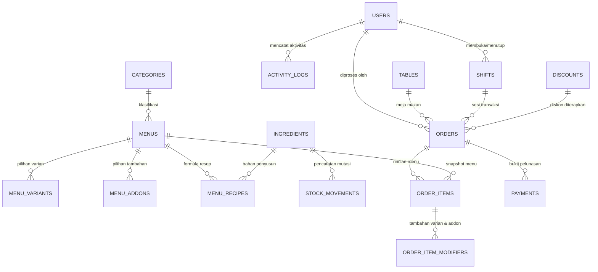
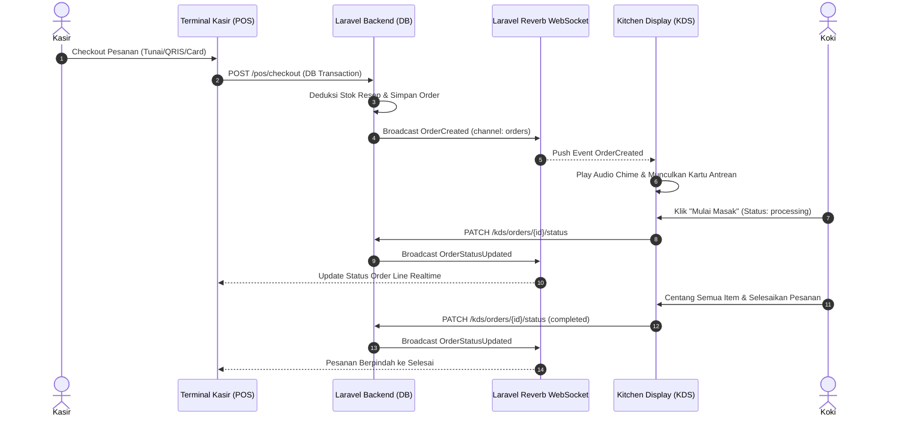

# 🍽️ Amarta Boga POS — Enterprise Restaurant Management & Kitchen Display System

<p align="center">
  
</p>

<p align="center">
  
  
  
  
  
  
  
</p>

---

## 📌 Ringkasan Sistem

**Amarta Boga POS** adalah aplikasi kasir restoran komprehensif, modern, dan berkinerja tinggi yang dirancang untuk operasional F&B berkecepatan tinggi. Aplikasi ini mengintegrasikan **Katalog Penjualan Kasir (POS)**, **Sistem Antrean Dapur Realtime (Kitchen Display System / KDS)** dengan WebSockets, **Manajemen Stok Berbasis Resep Otomatis**, **Rekonsiliasi Shift Kasir**, **Parkir Pesanan (Hold Order)**, serta **Laporan Keuangan & Analitik Bisnis** lengkap dengan ekspor Microsoft Excel dan PDF.

UI/UX didesain khusus mengikuti standar tablet kasir modern:
- **Layar Login Elegan**: Split layout foto kuliner segar dengan aksen merah oranye.
- **Layar Kasir POS**: Rail samping gelap (*compact slim rail*), panel tengah antrean horizontal (*Order Line*), tab kategori menu bergaris bawah (*underline tabs*), katalog menu kartu dengan harga oranye `#FF6B00`, dan panel kanan pesanan aktif (*Current Order*) yang intuitif.

---

## 🚀 Fitur Utama

### 1. Autentikasi & Hak Akses Berbasis Peran (RBAC)
- **Multi-Role**: Admin Toko, Kasir (Staff), dan Koki (Kitchen).
- **Auto-Redirect Peran**: Admin ke Dashboard Analitik, Kasir ke Terminal POS, Koki langsung ke Layar KDS.
- **Proteksi Otorisasi**: Middleware Spatie Permission ketat dengan pesan alert dan pembatasan menu navigasi.

### 2. Modul Kasir POS (Point of Sale)
- **Katalog Menu Cepat**: Pencarian instan (F1), filter kategori dinamis, dan penanda sold out realtime.
- **Kustomisasi Modifiers**: Pilihan varian menu (radio) dan add-ons tambahan (checkbox) dengan penyesuaian harga otomatis.
- **Multi-Metode Pembayaran**:
  - Tunai (Cash) dengan tombol uang pas dan pecahan cepat (Rp 50k, 100k, 200k, 500k) serta kalkulasi kembalian.
  - Dinamis QRIS (BCA, GoPay, OVO, Dana, ShopeePay, Livin Mandiri) dengan nomor referensi unik.
  - Kartu Debit / EDC (BCA, Mandiri, BRI, BNI) dengan input 4 digit terakhir kartu.
  - Split Bill (Bagi tagihan rata 2, 3, hingga 4 orang dengan metode bayar terpisah).
- **Cetak Struk Thermal**: Dukungan format lebar 58mm dan 80mm dengan CSS `@media print` dan unduhan file PDF struk.
- **Parkir Pesanan (Hold Order)**: Menahan sementara pesanan tamu untuk melayani antrean lain, lalu memanggil kembali (*resume*) atau membatalkan (*void*).
- **PWA & Offline Cart Resilience**: Keranjang tersimpan di `localStorage` peramban sehingga tidak hilang jika koneksi internet terputus sesaat.
- **Shortcut Keyboard Cepat**: `F1` (Cari Menu), `F2` (Kelola Shift), `F4` (Parkir Pesanan), `F9` (Bayar), `Esc` (Tutup Modal).

### 3. Kitchen Display System (KDS) Realtime
- **FIFO Order Queue**: Pesanan otomatis tersusun rapi dari yang paling awal masuk.
- **Indikator Stopwatch Visual**:
  - 🟢 Hijau (< 10 menit): Pesanan baru / waktu aman.
  - 🟡 Kuning (10 - 20 menit): Perlu atensi / sedang dimasak.
  - 🔴 Merah (> 20 menit): Pesanan terlambat (*overdue*).
- **Audio Chime Synthesizer**: Bunyi bel dapur otomatis berbasis Web Audio API (frekuensi 587.33Hz & 880Hz) tanpa file audio eksternal.
- **Item Plating Checklist**: Coret centang per porsi masakan saat siap disajikan.
- **Pembatalan Item Dapur**: Koki dapat membatalkan item tertentu dengan alasan wajib (misal: bahan habis/rusak).
- **Sold Out Toggle**: Koki dapat langsung menandai menu habis dari layar KDS dan langsung menonaktifkan tombol pesan di kasir.

### 4. Manajemen Bahan Baku & Resep Otomatis
- **Pengurangan Stok Otomatis**: Setiap menu yang dibayar langsung memotong stok bahan baku berdasarkan formula resep.
- **Snapshot HPP (COGS)**: Mencatat harga pokok produksi pada saat transaksi terjadi untuk kalkulasi laba kotor yang akurat.
- **Riwayat Mutasi Stok**: Audit jejak mutasi masuk (*in*), keluar (*out*), penyesuaian (*adjustment*), dan penjualan (*order_deduction*).

### 5. Audit & Rekapitulasi Shift Kasir
- **Buka Shift**: Kasir memasukkan modal awal laci uang tunai sebelum melayani transaksi.
- **Kalkulasi Selisih (Variance)**: Sistem otomatis menghitung total uang tunai yang diharapkan (*starting cash + cash sales*) vs kas fisik aktual di laci.
- **Badge Status Keuangan**: Seimbang (Rp 0), Surplus (+Rp), atau Defisit (-Rp).
- **Laporan Shift Admin**: Rekap lengkap seluruh kasir, jam operasional, dan riwayat selisih kas.

### 6. Laporan & Analitik Penjualan
- **Filter Rentang Tanggal**: Hari Ini, Kemarin, 7 Hari Terakhir, 30 Hari Terakhir, Bulan Ini, dan Kustom Tanggal.
- **8 Indikator Keuangan (KPI)**: Omzet Bersih, Omzet Kotor, Total Order, AOV, Total Pajak (PB1 11%), Diskon Promo, HPP (COGS), dan Laba Kotor & Margin %.
- **Visualisasi Chart.js**:
  - Line Chart: Tren pergerakan omzet harian.
  - Doughnut Chart: Komposisi pendapatan per metode bayar.
  - Bar Chart: 8 Menu kuliner paling laris (*top performers*).
- **Ekspor Data**:
  - Microsoft Excel (`.xlsx`): Header oranye, auto-size kolom, format mata uang otomatis.
  - PDF Format Landscape A4: Kop resmi, ringkasan KPI, dan tabel transaksi siap cetak.

### 7. Keamanan & Performa Tinggi
- Validasi ketat menggunakan Laravel Form Request.
- Proteksi CSRF, XSS filter, SQL Injection prevention lewat PDO binding.
- Database indexing komprehensif pada foreign keys, status, dan timestamp.
- Route caching, config caching, view caching, dan event caching.
- Backup database terjadwal otomatis (`php artisan app:backup-db`) setiap pukul 02:00 dini hari.

---

## 🗄️ Diagram Relasi Entitas (ERD)



---

## ⚡ Siklus Hidup Event WebSocket (Reverb)



---

## 👤 Akun & Kredensial Default

Database seeder telah menyiapkan 3 akun operasional siap pakai:

| Peran | Nama | Alamat Email | Password | URL Redirect Utama |
|---|---|---|---|---|
| **Admin** | Administrator Amarta | `admin@amartaboga.com` | `password` | `/admin/dashboard` |
| **Kasir (Staff)** | Kasir Utama | `kasir@amartaboga.com` | `password` | `/pos` |
| **Koki (Kitchen)** | Kepala Koki Dapur | `koki@amartaboga.com` | `password` | `/kds` |

---

## 🛠️ Panduan Instalasi & Menjalankan Aplikasi

### Kebutuhan Minimum Sistem:
- **PHP**: Versi 8.2 atau 8.4 (Direkomendasikan PHP 8.4)
- **Database**: MySQL 8.0+ atau MariaDB 10.5+
- **Node.js**: Versi 18+ & NPM
- **Composer**: Versi 2.x

### Langkah 1: Kloning & Pengaturan Dependensi
```bash
# Masuk ke direktori proyek
cd c:\Users\jathniel\.vscode\Kasir

# Install dependensi PHP via Composer
composer install

# Install dependensi JavaScript via NPM
npm install
```

### Langkah 2: Konfigurasi Environment (`.env`)
Pastikan file `.env` telah dikonfigurasi:
```env
APP_NAME="Amarta Boga POS"
APP_ENV=local
APP_DEBUG=true
APP_URL=http://localhost:8000

DB_CONNECTION=mysql
DB_HOST=127.0.0.1
DB_PORT=3306
DB_DATABASE=kasir_pos
DB_USERNAME=root
DB_PASSWORD=

BROADCAST_CONNECTION=reverb
QUEUE_CONNECTION=database

REVERB_APP_ID=amarta_boga_pos
REVERB_APP_KEY=amarta_key_2026
REVERB_APP_SECRET=amarta_secret_2026
REVERB_HOST="localhost"
REVERB_PORT=8080
REVERB_SCHEME=http

VITE_REVERB_APP_KEY="${REVERB_APP_KEY}"
VITE_REVERB_HOST="${REVERB_HOST}"
VITE_REVERB_PORT="${REVERB_PORT}"
VITE_REVERB_SCHEME="${REVERB_SCHEME}"
```

### Langkah 3: Database Migration & Seeding
```bash
# Jalankan migrasi seluruh tabel dan seeder data lengkap
php artisan migrate:fresh --seed
```

### Langkah 4: Kompilasi Aset Frontend
```bash
# Build production assets (Vite)
npm run build
```

### Langkah 5: Menjalankan Server Lokal
Jalankan layanan berikut di terminal terpisah:
```bash
# Terminal 1: Web Server Laravel
php artisan serve --port=8000

# Terminal 2: Laravel Reverb WebSocket Server
php artisan reverb:start --port=8080

# Terminal 3: Queue Worker
php artisan queue:work --sleep=3 --tries=3
```

Akses sistem di browser: `http://localhost:8000`

---

## 🧪 Eksekusi Pengujian Otomatis (Automated Tests)

Aplikasi dilengkapi pengujian unit dan fitur komprehensif menggunakan PHPUnit:

```bash
# Menjalankan seluruh 48 feature tests
php artisan test
```

### Rincian Cakupan Test:
- **`AuthTest`**: Form login, proteksi rute, logout, dan auto-redirect sesuai role.
- **`RoleAccessTest`**: Otorisasi batas akses kasir, koki, dan admin.
- **`AdminModuleTest`**: CRUD user, kategori, menu, resep, inventaris bahan baku, meja, diskon, dan pengaturan resto.
- **`CashierModuleTest`**: Transaksi kasir POS, kalkulasi PB1 & service charge, multi-pembayaran, split bill, deduksi stok resep, cetak struk thermal 58/80mm, dan download PDF struk.
- **`KdsModuleTest`**: Antrean KDS, perubahan status berjenjang, centang checklist item, pembatalan item dapur, dan toggle sold-out menu.
- **`ReportAndShiftTest`**: Dashboard analitik, preset tanggal, ekspor Excel `.xlsx`, ekspor PDF A4, buka & rekonsiliasi tutup shift kasir, kalkulasi selisih kas (*variance*), serta parkir pesanan (*hold*/*resume*/*void*).

---

## 🌐 Panduan Deployment Produksi (Linux Server)

Direktori `deployment/` telah dilengkapi berkas konfigurasi siap pakai:

### 1. Nginx Server Block
Salin berkas konfigurasi ke server Nginx:
```bash
sudo cp deployment/nginx.conf /etc/nginx/sites-available/amarta-pos.conf
sudo ln -s /etc/nginx/sites-available/amarta-pos.conf /etc/nginx/sites-enabled/
sudo nginx -t && sudo systemctl reload nginx
```

### 2. Supervisor untuk Queue Worker & Laravel Reverb
Salin berkas supervisor worker:
```bash
sudo cp deployment/supervisor-queue.conf /etc/supervisor/conf.d/amarta-pos-queue.conf
sudo cp deployment/supervisor-reverb.conf /etc/supervisor/conf.d/amarta-pos-reverb.conf

# Reload supervisor
sudo supervisorctl reread
sudo supervisorctl update
sudo supervisorctl start all
```

### 3. Cron Job Laravel Scheduler
Jalankan perintah crontab untuk pengguna web server (`www-data`):
```bash
crontab -e -u www-data
```
Tambahkan baris berikut:
```cron
* * * * * cd /var/www/amarta-pos && php artisan schedule:run >> /dev/null 2>&1
```

### 4. Perintah Optimasi Produksi Laravel
Jalankan perintah optimasi berikut setelah melakukan rilis versi baru:
```bash
# Cache konfigurasi, rute, dan view
php artisan config:cache
php artisan route:cache
php artisan view:cache
php artisan event:cache

# Optimasi autoloader Composer
composer install --optimize-autoloader --no-dev

# Kompilasi aset Vite untuk produksi
npm run build
```

---

## 📄 Lisensi & Hak Cipta

Aplikasi ini dikembangkan untuk **Restoran Amarta Boga**. Seluruh hak cipta dilindungi undang-undang.
